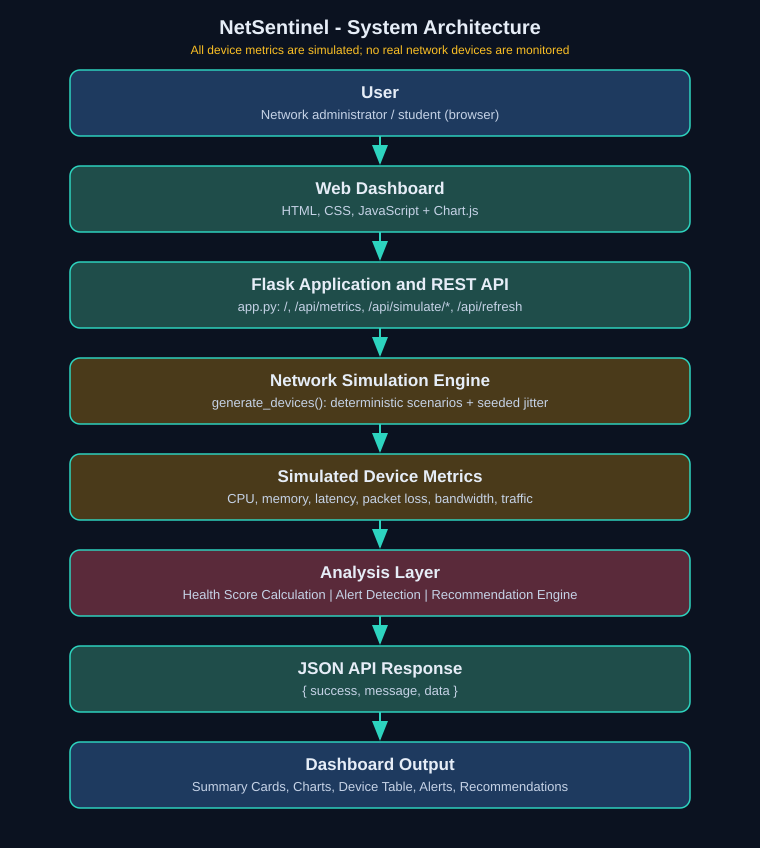

# NetSentinel: A Simulation-Based Network Performance Monitoring and Visualization Dashboard with Intelligent Health Scoring and Threshold-Based Alerts

**Subject:** Network Management System (NMS) | **Type:** Mini-Project

| | |
|---|---|
| Student name | [Your Name] |
| Register number | [Register No.] |
| Department | Information Technology (B.Tech, Final Year) |
| College | [College Name] |
| Guide name | [Guide Name] |
| Academic year | [20XX - 20XX] |

---

## 1. Abstract
Monitoring many network devices by hand is slow and error-prone. NetSentinel (dashboard name NetPulse) is a web-based Network Management System prototype that **simulates** six network devices and shows their performance metrics in one dashboard. It calculates a 0-100 network health score, raises threshold-based alerts and generates recommendations. The backend uses Python and Flask; the frontend uses HTML, CSS, JavaScript and Chart.js. **The project is entirely simulation-based: no physical network equipment or production network was monitored or tested.**

## 2. Introduction
Network management covers fault, configuration, accounting, performance and security management (FCAPS). This project addresses performance and fault management by presenting key indicators (latency, packet loss, CPU, memory and bandwidth utilization) and detecting abnormal conditions. Simulated data lets the system run on a normal laptop without hardware or paid services.

## 3. Problem Statement
Network administrators need an easy way to monitor devices, track performance, identify problems and receive alerts. Checking multiple devices manually is time-consuming. A centralized dashboard is needed to visualize performance, detect threshold violations and suggest corrective action.

## 4. Objectives
1. Simulate network devices and their metrics.
2. Display metrics through a responsive dashboard with charts and tables.
3. Calculate a transparent network health score.
4. Detect warning and critical conditions automatically.
5. Provide recommendations based on the detected issues.

## 5. Existing System and Its Limitations
Typical existing approaches are command-line checks (ping, traceroute, per-device consoles) and enterprise tools such as Nagios, Zabbix or SolarWinds. Limitations: manual checking does not scale and gives no history; enterprise tools need servers, real devices, configuration effort and sometimes licences, which makes them hard to use in a classroom; many show raw numbers without a single easy-to-read health indicator.

## 6. Proposed System
A lightweight Flask web application with a built-in simulation engine. It offers deterministic normal, warning and critical scenarios, a weighted health score, automatic alerts with severity and recommended actions, and a dashboard that updates after every scenario change. It runs locally with two commands.

## 7. Hardware and Software Requirements
**Hardware:** any laptop/PC (2 GB RAM or more). No networking equipment is needed.
**Software:** Windows 10/11, Python 3.9+, Flask, a modern browser, VS Code or PowerShell. Chart.js 4.4.1 is loaded from a CDN, so internet is needed only for the charts.

## 8. System Architecture
The architecture is shown in `architecture.svg`.



Flow: User, Web Dashboard (HTML/CSS/JS), Flask application and REST API, Network Simulation Engine, Simulated Device Metrics, then Health Score Calculation + Alert Detection + Recommendation Engine, JSON API response, and finally Dashboard cards, charts, device table and alerts.

## 9. Module Descriptions
- **Simulation engine** (`generate_devices`): returns metrics for six devices (Core Router, Access Switch, Application Server, Database Server, Firewall, Wireless AP). Each scenario has fixed base values plus small seeded random variation, so results are repeatable. Addresses use the reserved documentation range 192.0.2.0/24.
- **Health score module** (`calculate_health`): weighted score and component breakdown.
- **Alert module** (`generate_alerts`, `apply_status`): compares metrics with thresholds and sets device status.
- **Recommendation module** (`build_recommendations`): maps each alert to an explanation and next step; shows a positive message when healthy.
- **REST API** (Flask routes): `/api/metrics`, `/api/simulate/<scenario>`, `/api/refresh`, `/api/alerts`, `/api/thresholds`, all returning `{success, message, data}`.
- **Dashboard UI**: summary cards, device table with search and status filter, five Chart.js charts, alerts view and scenario controls.

## 10. Algorithm for Health Score Calculation
1. For each metric, compute a sub-score: 100 if value is at or below the *good* limit, 0 if at or above the *bad* limit, otherwise `100 x (bad - value) / (bad - good)`.

   | Metric | Good | Bad | Weight |
   |---|---|---|---|
   | Latency | 20 ms | 200 ms | 0.20 |
   | Packet loss | 0.5% | 6% | 0.25 |
   | CPU | 40% | 100% | 0.15 |
   | Memory | 50% | 100% | 0.10 |
   | Bandwidth | 50% | 100% | 0.15 |
   | Availability | online / total x 100 | | 0.15 |
2. Compute the sub-score for every reachable device, then combine per metric as `0.7 x average + 0.3 x worst` so a single bad device lowers the score.
3. `score = round(sum(weight x component))`, limited to 0-100.
4. Label: 90-100 Excellent, 75-89 Good, 50-74 Warning, 0-49 Critical.

## 11. Threshold-Based Alert Algorithm
```
for each device:
    if device is offline:  raise ONE critical alert; continue
    for each metric (cpu, memory, latency, packet_loss, bandwidth):
        if critical limit exists and value > critical:  raise critical alert
        else if value > warning:                         raise warning alert
```
Limits: CPU 80/95 %, memory 85/95 %, latency 100/200 ms, packet loss 2/5 %, bandwidth 80 % (warning only). Because the critical test comes first, one metric never creates both alert levels. Each alert stores severity, device, description, value, threshold, timestamp and recommended action. Device status is Offline, Critical, Warning or Online, in that order of precedence.

## 12. Testing and Sample Results
Ten automated tests (`python -m unittest`) and manual HTTP checks against the running Flask server were executed during development, and all passed. They cover: page loads (HTTP 200), valid JSON from every endpoint, scenario behaviour, score ordering, label/score consistency, no duplicate alerts, refresh/reset, and JSON error responses (404 for an unknown scenario, 405 for a wrong method).

| Scenario | Alerts | Device status | Health score | Label |
|---|---|---|---|---|
| Normal | 0 | 6 Online | about 97 | Excellent |
| Warning | 6 warning, 0 critical | 4 Warning, 2 Online | about 70-71 | Warning |
| Critical | 7 critical, 10 warning | 1 Offline, 2 Critical, 2 Warning, 1 Online | about 38 | Critical |

Browser behaviour (chart rendering, button clicks, search and filters, console errors) should be confirmed by running the application and following the scenarios in the README; this was not verified in an actual browser during development.

## 13. Advantages
Simple installation, no hardware or paid service, repeatable demonstrations, transparent scoring, clear visual severity, readable beginner-friendly code and a clean separation between simulation, scoring, alerting and presentation.

## 14. Limitations
Data is simulated and does not represent real network behaviour; no SNMP or ICMP polling; in-memory state only (lost on restart); no authentication; no automatic live refresh; Chart.js requires internet via CDN.

## 15. Future Enhancements
Real device polling (SNMP/ICMP), persistent storage (SQLite), email/SMS notifications, user login, editable thresholds in the interface, anomaly detection using machine learning, network topology map and report export.

## 16. Conclusion
NetSentinel demonstrates core NMS performance-monitoring ideas, namely metric collection, visualization, health scoring, threshold-based alerting and recommendations, in a lightweight web dashboard. Although the data is simulated, the design separates simulation from analysis so a real data source could replace the simulator later.

## 17. References
1. Flask Documentation, https://flask.palletsprojects.com
2. Chart.js Documentation, https://www.chartjs.org/docs
3. W. Stallings, *SNMP, SNMPv2, SNMPv3, and RMON 1 and 2*, Addison-Wesley.
4. RFC 1157, *A Simple Network Management Protocol (SNMP)*, IETF.
5. RFC 5737, *IPv4 Address Blocks Reserved for Documentation*, IETF.
6. ITU-T M.3400, TMN management functions (FCAPS).
